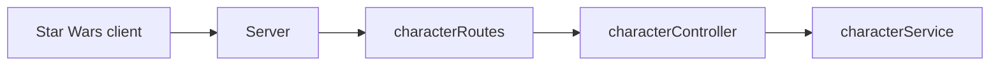

# Star Wars Web
## Arkitektur

## Installation / Start-vejledning
1. Klon projektet
2. Kør `npm install` i rod-mappen
3. For at kører program, kør `npm run dev`
4. Åben browser på http://localhost:3000

## Diskuter
**Hvor skal HTTP-requests håndteres?**

controlleren

**Hvor skal karakterdata gemmes?**

json fil kan også være  mongoDB

**Hvor skal valideringen placeres?**

middelware og services alt efter hvilken type validering 

**Hvad er fordelen ved jeres valgte arkitektur?**

et ansvar for hver del af applikationen per lag 

**Hvilke ulemper har den?**

boilerplate kode,
dublicering af logik 

## Besvar kort:

Hvilken arkitektur har I valgt, og hvorfor?

Hvad ville I ændre, hvis applikationen skulle anvendes af mange brugere?

Hvilke fejl fandt I under udvikling og test?

Hvilken forbedring gennemførte I efter kode-review?

Hvad lærte I om samspillet mellem frontend og backend?

## Undersøg (Mission 2)
**Hvorfor er det en dårlig idé udelukkende at bruge arrayets længde som ID?**

Hvis du sletter et element i arrayet, vil længden ændre sig, og ID'erne vil ikke længere være unikke.

**Hvad sker der med karaktererne, når serveren genstartes?**

De vil blive slettet, da de ikke er gemt i en persistent database eller json fil.

## Eksperiment (Mission 3)

Fjern midlertidigt next() fra jeres logging-middleware.

Send derefter en request med Postman.

**Undersøg, hvad der sker, og forklar hvorfor:**

Den bliver ved med at loade, fordi next() ikke bliver kaldt kan middlewaren, og derfor kan requesten gå ikke videre til den næste middleware eller route handler.

## REFLEKSION
Hvad er forskellen på:

- 400 Bad Request
- 404 Not Found
- 500 Internal Server Error

**Hvorfor skal serveren ikke returnere 500, blot fordi en karakter ikke findes?**

Fordi at 500 indikerer en serverfejl, hvilket ikke er tilfældet, når en karakter ikke findes. I stedet bør serveren returnere 404 Not Found, da det indikerer, at den ønskede ressource ikke eksisterer.

 ## Kode review: 
Gennemfør et kode-review af jeres egen løsning.

Undersøg:

Har funktionerne klare ansvarsområder?

Er HTTP-håndtering og forretningslogik blandet sammen?

Er der gentaget kode?

Er valideringen placeret fornuftigt?

Er fejlbehandlingen konsekvent?

Er koden let at forstå for en ny udvikler?

Find mindst tre konkrete forbedringsmuligheder.

I skal implementere mindst én af forbedringerne.

Beskriv i README, hvad I ændrede, og hvorfor. 

## Forkar del af opgave 5:
**Hvilken HTTP-metode bliver anvendt?**

GET

**Hvilken statuskode returnerer serveren?**

304 not modified

**Hvad indeholder response-bodyen?**

Liste af charakterer i JSON-format

**Hvordan bliver JSON omsat til elementer på hjemmesiden?**

Ved hjælp af JavaScript, hvor JSON-dataen parses og bruges til at oprette HTML-elementer, som vises på siden (document.createElement()).

## Afsluttende refleksion

Alle i gruppen skal kunne forklare:

Hvad der sker, når frontend sender en request til backend.

Hvordan Express finder den rigtige route.

Hvor data bliver valideret.

Hvordan HTTP-statuskoder anvendes.

Hvordan applikationen er opdelt.

Hvordan I har testet funktionaliteten.

I skal kunne demonstrere applikationen og forklare jeres kode.

