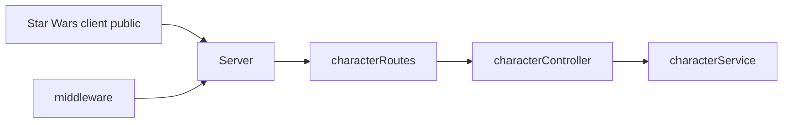

# Star Wars Web
## Arkitektur

## Installation / Start-vejledning
1. Klon projektet
2. Kør `npm install` i rod-mappen
3. For at kører program, kør `npm run dev`
4. Åben browser på http://localhost:3000

## Diskuter
**Hvor skal HTTP-requests håndteres?**

controlleren

**Hvor skal karakterdata gemmes?**

json fil kan også være  mongoDB

**Hvor skal valideringen placeres?**

middelware og services alt efter hvilken type validering 

**Hvad er fordelen ved jeres valgte arkitektur?**

et ansvar for hver del af applikationen per lag 

**Hvilke ulemper har den?**

boilerplate kode,
dublicering af logik 

## Besvar kort:

Hvilken arkitektur har I valgt, og hvorfor?
vi har valgt en klient-server arkitektur, fordi det er en standard måde at opbygge webapplikationer på, hvor frontend og backend er adskilt.

Hvad ville I ændre, hvis applikationen skulle anvendes af mange brugere?
database eller rate limit fordi det er nødvendigt at håndtere store mængder af data og forespørgsler.

Hvilke fejl fandt I under udvikling og test?
valildering opretted aligevel 

Hvilken forbedring gennemførte I efter kode-review?

Hvad lærte I om samspillet mellem frontend og backend?

## Undersøg (Mission 2)
**Hvorfor er det en dårlig idé udelukkende at bruge arrayets længde som ID?**

Hvis du sletter et element i arrayet, vil længden ændre sig, og ID'erne vil ikke længere være unikke.

**Hvad sker der med karaktererne, når serveren genstartes?**

De vil blive slettet, da de ikke er gemt i en persistent database eller json fil.

## Eksperiment (Mission 3)

Fjern midlertidigt next() fra jeres logging-middleware.

Send derefter en request med Postman.

**Undersøg, hvad der sker, og forklar hvorfor:**

Den bliver ved med at loade, fordi next() ikke bliver kaldt kan middlewaren, og derfor kan requesten gå ikke videre til den næste middleware eller route handler.

## REFLEKSION
Hvad er forskellen på:

- 400 Bad Request
- 404 Not Found
- 500 Internal Server Error

**Hvorfor skal serveren ikke returnere 500, blot fordi en karakter ikke findes?**

Fordi at 500 indikerer en serverfejl, hvilket ikke er tilfældet, når en karakter ikke findes. I stedet bør serveren returnere 404 Not Found, da det indikerer, at den ønskede ressource ikke eksisterer.

 ## Kode review: 
Gennemfør et kode-review af jeres egen løsning.

Undersøg:

Har funktionerne klare ansvarsområder?

ja vores funktioner har klare ansvarsområder, hvor controlleren håndterer HTTP-requests, service håndterer forretningslogik og datahåndtering, og middleware håndterer fejl af validering og logging.

Er HTTP-håndtering og forretningslogik blandet sammen?

nej vi har en service, der håndterer forretningslogik og datahåndtering, mens controlleren håndterer HTTP-requests.

Er der gentaget kode? 

id validering er gentaget i flere funktioner, hvilket kan føre til fejl og inkonsistens.
men i validering i create og update har vi lavet en funktion der kan genbruges, 

Er valideringen placeret fornuftigt?
 
vi har sat validering efter id validering, så vi først tjekker om id er valid, og derefter tjekker vi om dataen er valid.
der efter må programet gå videre til service, hvor dataen bliver gemt.

Er fejlbehandlingen konsekvent?

alle de fejl vi har funder fanges i controlleren, og vi returnere en statuskode og en fejlbesked til klienten.

Er koden let at forstå for en ny udvikler?

vi kan forstå koden, men vi kunne godt sette kommentarer på funktioner og metoder, så det er lettere for en ny udvikler at forstå koden.

Find mindst tre konkrete forbedringsmuligheder.

input validering puttes i middelware, så det er lettere at genbruge og vedligeholde.
rate limit, så vi kan begrænse antallet af requests fra en bruger, og dermed beskytte serveren mod overbelastning.
enu et lag for database logik, så vi kan skifte fra json fil til en database, uden at skulle ændre på controlleren eller service.

I skal implementere mindst én af forbedringerne.

input validering puttes i middelware, så det er lettere at genbruge og vedligeholde.

Beskriv i README, hvad I ændrede, og hvorfor. 

vi har lavet 2 nye middelware funktioner, validateId og validateCharacterData, som validerer id og karakterdataen, så vi kan genbruge dem i flere routes, og dermed undgå gentagelse af kode og gøre det lettere at vedligeholde.

## Forkar del af opgave 5:
**Hvilken HTTP-metode bliver anvendt?**

GET

**Hvilken statuskode returnerer serveren?**

304 not modified

**Hvad indeholder response-bodyen?**

Liste af charakterer i JSON-format

**Hvordan bliver JSON omsat til elementer på hjemmesiden?**

Ved hjælp af JavaScript, hvor JSON-dataen parses og bruges til at oprette HTML-elementer, som vises på siden (document.createElement()).

## kort forklaring opgave 7:

Hvorfor I har valgt arkitekturen.

svaret står oppe i starten under besvar kort  

Hvordan I har fordelt ansvar.

public folder indeholder alt frontend kode, 
controller hånterer HTTP-requests,
middelware validering af http-requests og logging af requests,
routes angiver hvilke requests der skal håndteres af hvilken controller aka endpoints,
service business logic og håndtering af data,
server starter express serveren og sætter routes op og middelware op.

Hvad der fungerer godt.

error handling, fanger fejl i validering samlet, logging timesamp virker som det skal og forteller os routes der bliver kaldt, enkel separation of concerns.

Hvad I ville ændre, hvis projektet voksede.

database, rate limit, validering i middelware,sletning af karakterer tilgenlig for alle brugere, unit tests,

## opgave 7 C ai code review:
ai's samlet vudering af vore projekt,

Lagdelingen er påbegyndt fornuftigt: routes binder middleware og controllers sammen, mens servicen ejer karakterdata.
Den vigtigste arkitektoniske svaghed er, at validering, normalisering og API-kontrakt ikke er defineret konsekvent mellem middleware, controller og service.
Der findes kun en Postman collection og ingen automatiske tests i test/, så de tre områder bør især dækkes af integrationstests for ugyldige input, servicefejl samt POST/PUT/DELETE-responser.

hvad den forslog 

1. Fejlhåndteringen eksponerer interne fejl til klienten
2. Validering og normalisering er ikke konsekvent fordelt
3.  HTTP- og dataansvaret er ikke helt korrekt modelleret

hvad vi har ladet den endre og hvorfor  
vi har ændret 2. validering og normalisering er ikke konsekvent fordelt for at have en konsekvent validering i middelware, så vi kan genbruge den i flere routes, og dermed undgå gentagelse af kode og gøre det lettere at vedligeholde og have en bedre validering .
vi har også ændret 3. http- og dataansvaret er ikke helt korrekt modelleret fordi vi fik givet delete en content og vi har ændret hvordan vi laver id så det er mere korrekt og ikke giver fejl
## Afsluttende refleksion

Alle i gruppen skal kunne forklare:

Hvad der sker, når frontend sender en request til backend.

Hvordan Express finder den rigtige route.

Hvor data bliver valideret.

Hvordan HTTP-statuskoder anvendes.

Hvordan applikationen er opdelt.

Hvordan I har testet funktionaliteten.

I skal kunne demonstrere applikationen og forklare jeres kode.

