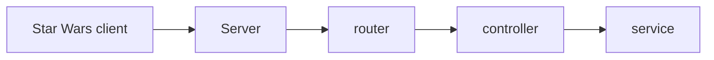

# Star Wars Web Arkitektur

diskuter
Hvor skal HTTP-requests håndteres?

controlleren

Hvor skal karakterdata gemmes?

json fil kan også være  mongoDB

Hvor skal valideringen placeres?

middelware  og  services alt efter hvilken type validering 

Hvad er fordelen ved jeres valgte arkitektur?

et ansvar for hver del af applikationen per lag 

Hvilke ulemper har den? 

boilerplate kode,
dublicering af logik 

 
## løsning dokumentation

## Besvar kort:

Hvilken arkitektur har I valgt, og hvorfor?

Hvad ville I ændre, hvis applikationen skulle anvendes af mange brugere?

Hvilke fejl fandt I under udvikling og test?

Hvilken forbedring gennemførte I efter kode-review?

Hvad lærte I om samspillet mellem frontend og backend?

## Afsluttende refleksion

Alle i gruppen skal kunne forklare:

Hvad der sker, når frontend sender en request til backend.

Hvordan Express finder den rigtige route.

Hvor data bliver valideret.

Hvordan HTTP-statuskoder anvendes.

Hvordan applikationen er opdelt.

Hvordan I har testet funktionaliteten.

I skal kunne demonstrere applikationen og forklare jeres kode. 

 ## Kode review: 
Gennemfør et kode-review af jeres egen løsning.

Undersøg:

Har funktionerne klare ansvarsområder?

Er HTTP-håndtering og forretningslogik blandet sammen?

Er der gentaget kode?

Er valideringen placeret fornuftigt?

Er fejlbehandlingen konsekvent?

Er koden let at forstå for en ny udvikler?

Find mindst tre konkrete forbedringsmuligheder.

I skal implementere mindst én af forbedringerne.

Beskriv i README, hvad I ændrede, og hvorfor. 